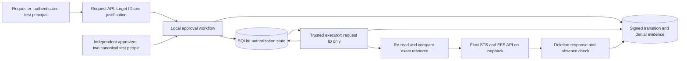
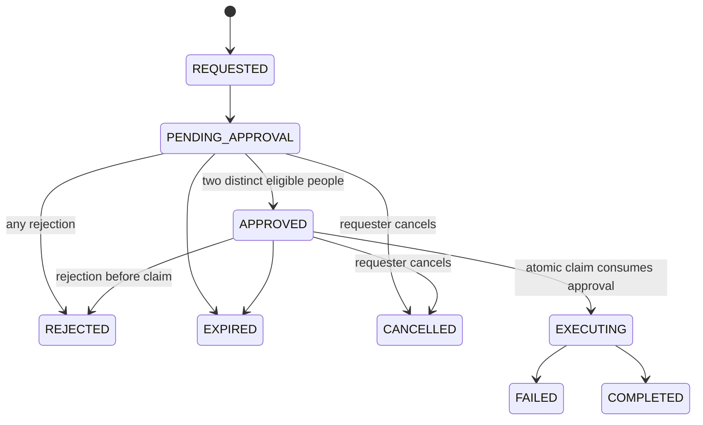

# Operation-specific authorization

The local approval adapter is independent of boto3. AWS-shaped calls live in the Floci gateway. Replacing the adapter with SSM does not make either the human identity problem or the executor's authorization checks disappear.

## Responsibilities

| Module | Responsibility |
|---|---|
| `authorization/isolation.py` | Endpoint allowlist, explicit credentials, per-send guard, no public AWS fallback |
| `authorization/identity.py` | Test bearer authentication and canonical person/role mapping |
| `approval/workflow.py` | Policy, decisions, expiry, cancellation, quorum and one-attempt claim; no AWS imports |
| `audit/store.py` | SQLite transactions, immutable payload trigger, integrity verification and evidence |
| `executor/efs.py` | Floci resource discovery, disposable seeding, STS session and exact EFS API |
| `executor/service.py` | Authorization claim, fresh resource comparison, deletion and receipt |
| `service.py` | Operator bootstrap and a small requester-facing API |

The API accepts no command, script, deletion ARN, caller identity or `approved` flag. `RequestService.submit` reads the target itself. `Executor.execute` takes an authenticated executor token and a stored request ID. Approvers inspect `workflow.status(token, request_id)` and call `workflow.decide(token, request_id, "approve" / "reject")`; they cannot replace the stored payload. There is no public HTTP server or pending-request index in this minimal pilot.

## Request and state

The signed request contains ID, canonical requester, synthetic account and Region, filesystem/access-point IDs, operation, complete observed access-point snapshot, relevant parent-filesystem snapshot, resource tags, pilot-instance ID, timestamps, expiration, policy version and justification. Its canonical JSON SHA-256 hash is stored beside the immutable payload and bound into each decision, state signature and receipt. Editing any field requires a new request, not an approval update.

Expiry is checked lazily when reading, deciding or claiming, and again after the resource reread. No background timer is needed to deny expired execution. A rejection or cancellation racing a claim is serialized by SQLite; once the claim wins, execution has started and cannot be cancelled through this API.

## Execution sequence

1. Authenticate the executor test principal and verify database/audit integrity.
2. Retrieve the request; verify state, hash, current policy, expiration and two eligible canonical non-requesters. A duplicate/alias never adds a second person.
3. In one transaction, claim the request and resource and persist `EXECUTING` plus its intent receipt. Another worker or independently approved request cannot concurrently claim that resource.
4. Re-read the access point and filesystem; verify the exact ARN, account, Region, IDs, lifecycle, all observed access-point fields, selected parent state/tags, and both disposable markers.
5. Recheck expiration and commit an `api_submitted` intent before attempting STS/EFS calls.
6. Assume the local executor role server-side with a session policy restricted to this exact access-point ARN. Do not give that session to a requester.
7. Call Floci `DeleteAccessPoint`, verify absence, and persist `COMPLETED` with AWS request ID, HTTP status, session identity and the original authorization evidence.
8. On failure, consume the attempt and persist `FAILED`. If the process crashes or persistence fails after the side effect, leave an indeterminate record rather than replaying it.

The local base role allows only access-point deletion for this disposable instance. The session policy narrows it to one ARN. This policy structure is exercised through STS but effective EFS authorization is **not enforced by this emulator**. Reconciliation must distinguish a definite pre-API failure from an unknown API result. After the latter, even a newly approved request is blocked on the retained resource claim.

## Trust and availability

The test operator owns all fixtures, tokens, key material and code. Random bearer secrets authenticate synthetic principals within the application; the pilot does not establish independence against that operator. Logical role checks are not a substitute for separate processes, production IdP validation, IAM and network boundaries.

Audit integrity is checked inside each transaction. Failed authorization attempts are recorded where they reach the workflow; input failures before a request exists need production ingress logging. The application offers no audit mutation endpoint. HMACs protect against tested record edits without the key, not a host administrator, complete snapshot rollback or deletion of all evidence.

If approval/state storage is unavailable, new protected operations fail closed. A worker that has already committed execution intent may finish its one API attempt; a second worker cannot claim it. There is no lease expiry that silently re-enables execution. Regular infrastructure operations and controllers have no dependency on this pilot, since no AWS or Kubernetes policies are changed. A future deployment must keep protected human operations separate from normal reconciler identities and avoid a global admission dependency.
